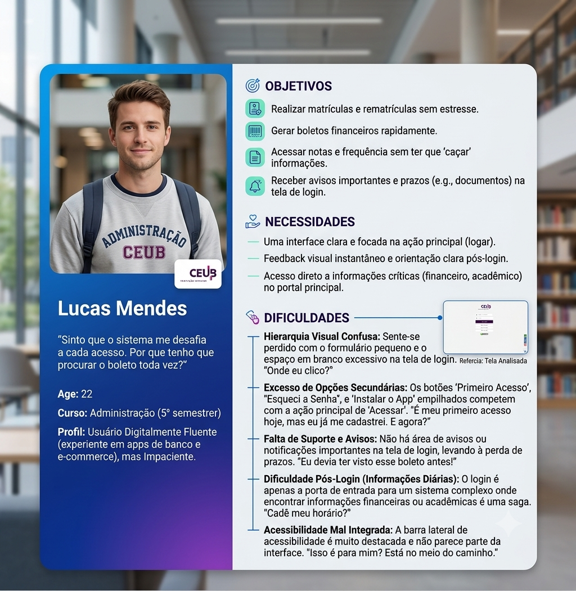
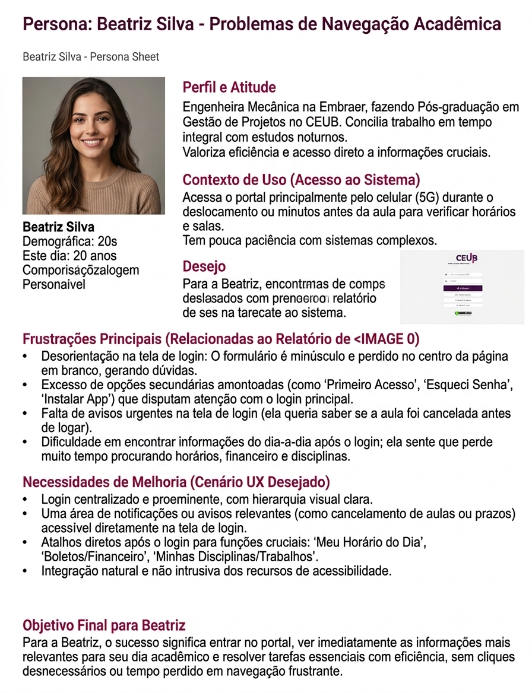

# Projeto de UX/UI: sistema acadêmico do UniCEUB

Estudo de usabilidade do sistema acadêmico que os alunos usam todo semestre para matrícula, notas e
documentos. O trabalho foi da disciplina de UX/UI do CEUB e seguiu o caminho completo, da pesquisa
com usuário real até a proposta de interface.

## Como foi conduzido

**1. Pesquisa.** Um formulário com alunos do curso, para entender onde eles travam de verdade em vez
de supor. As respostas estão em `Formulário Utilizado`.

**2. Personas.** Três perfis construídos a partir das respostas, cada um com a sua rotina, o seu
nível de familiaridade com o sistema e aquilo que mais o atrapalha.

| | |
|---|---|
|  |  |

**3. Análise e proposta.** O documento final reúne o diagnóstico dos pontos de atrito e a proposta de
interface, etapa por etapa.

## Arquivos

| Arquivo | O que é |
|---|---|
| `Projeto UX-UI - Sistema Academico UniCEUB.pdf` | Documento final, com diagnóstico e proposta |
| `Trabalho Até etapa 4.pdf` | Entrega parcial: pesquisa e personas |
| `Trabalho Até etapa 8.pdf` | Entrega parcial: análise e primeiras telas |
| `Persona1.png`, `Persona2.png`, `Persona3.png` | As três personas |
| `Formulário Utilizado` | O formulário aplicado na pesquisa |

## O que ficou de aprendizado

Conversar com cinco pessoas reais derrubou duas suposições que pareciam óbvias no começo. É barato
perguntar antes e caro desenhar em cima de palpite, que é a mesma lição que vale para software fora
da faculdade.
